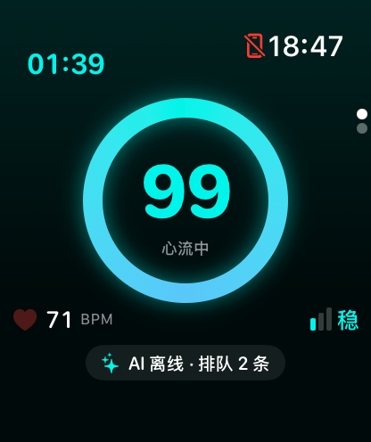
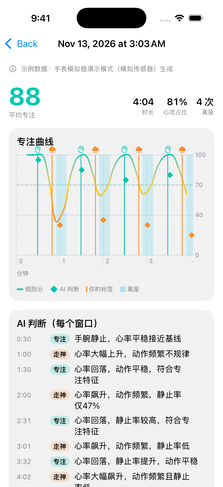

# Flowbeat · 心流

**Flowbeat** is an Apple Watch app that estimates whether you're in a state of focus ("flow") from your **heart rate** and **wrist motion**, and shows it as a live 0–100 focus score.

> Flowbeat 是一款 Apple Watch app：通过**心率**和**手腕动作**判断你是否进入了「心流」专注状态，实时给出 0–100 的专注指数。

> <p> </p>

**Status (2026-11-12):** everything below has run only in the **watchOS simulator** (demo mode with simulated sensors), in local tests, and in GitHub Actions. It has **never run on a real Apple Watch**, and the focus score has not been validated against real labeled data.

## Architecture

```
 Apple Watch (works offline)                      Backend (FastAPI :8765)              LLM
┌───────────────────────────────────────┐       ┌─────────────────────────────┐    ┌──────────────────┐
│ HealthKit HR (~5 s, workout session)  │       │ validate → token → judge    │    │ Qwen qwen3.8-flash│
│ HealthKit HRV/SDNN (optional, sparse) │       │                             │    │ (DashScope)       │
│ CoreMotion wrist accel (25 Hz)        │ every │ LLM call: 8 s timeout,      │───▶│                   │
│ Activity: walking/running → "away"    │ 2 min │ 1 retry on timeout/429/5xx  │◀───│ (Claude provider: │
│        │ every 1 s                    │──────▶│ else rule-score fallback    │    │  written, never   │
│ FocusEngine (rules) → ring 0–100      │summary│ → {state, score, reason,    │    │  run live)        │
│        │                              │       │    source: llm|fallback}    │    └──────────────────┘
│ JudgeSync queue: offline → backoff    │◀──────│ /v1/review on stop          │
│ 15 s…5 min, cap 30, in-order delivery │       │ /healthz · JSON access logs │
│ 专注/走神 labels → few-shot examples   │       │ API keys only in .env       │
│        │ on stop                      │       └─────────────────────────────┘
│ SessionRecord JSON ──WatchConnectivity transferFile──▶ iPhone: Swift Charts timeline
└───────────────────────────────────────┘
```

- **Per second, on the watch, offline**: the rule-based score shown in the ring (`FocusEngine` in `FlowbeatCore`).
- **Every 2 minutes, via the backend**: a statistics-only summary (no raw samples) goes to the LLM along with your own labeled examples. The on-device rule score is **not** shown to the LLM (see [Run 3](#run-3--2026-11-12-is-the-anchoring-gone)). If the backend is unreachable, windows queue on the watch and are retried with backoff. If the LLM fails, the backend falls back to the rule score.
- **On stop**: an AI review card. The session is saved to `Documents/sessions/*.json` (samples + windows + judgments + timeline + review) and sent to the iPhone app if it's installed.

## Code layout

| Path | Role |
|---|---|
| `FlowbeatCore/` (Swift package) | **Pure logic, unit-tested** on macOS (`swift test`) and on the watchOS simulator (`xcodebuild test`). |
| `FlowbeatCore/Sources/FlowbeatCore/FocusScorer.swift` | 60 s calibration (median resting HR) → motion penalty (≤ 60) + elevated-HR penalty (≤ 40) → exponential smoothing (α = 0.2). |
| `…/FocusEngine.swift` | Per-second flow: calibration → scoring, `AwayTracker` state machine, 60 s HR-recovery grace after sitting back down, session stats. |
| `…/Models.swift` | Wire models shared with the backend, plus `WindowSummary.make` (statistics-only summary). |
| `…/OfflineQueue.swift` | `OfflineQueue` + `JudgeSync` actor: FIFO, capacity 30, 1 h max age, queue-level exponential backoff, permanent-4xx drop. |
| `…/HRV.swift` | Latest plausible SDNN reading within 6 h, sent with its age. |
| `…/SessionTimeline.swift`, `…/SessionArchive.swift` | Chart data for the iPhone (bucketing, gaps, labels, away spans, judgments) and the iPhone's session store. |
| `FlowbeatCore/Sources/FlowbeatPhoneUI/` | iPhone SwiftUI + Swift Charts views (in the package so they compile on macOS too). |
| `Flowbeat/FocusSession.swift` | Watch: `HKWorkoutSession` (mind & body, discarded at the end) for background HR every few seconds, CoreMotion, timers, HRV query, networking via `JudgeSync`. |
| `Flowbeat/AIJudge.swift`, `Flowbeat/PhoneSync.swift` | Backend client and label store; WatchConnectivity `transferFile` to the iPhone. |
| `Flowbeat/ContentView.swift` | Start / in-session (vertical pages) / summary screens. |
| `FlowbeatPhone/` | iOS companion app: session list, detail chart, `WCSessionDelegate` receiver, bundled sample session. |
| `backend/app/` | FastAPI: `schemas.py` (validation), `prompts.py`, `providers.py` (Qwen / Claude / Fake), `resilience.py` (timeout, retry, fallback), `config.py`, `logs.py`, `main.py`. |
| `backend/scripts/compare_models.py` | Model + anchoring comparison. Raw results are in `backend/scripts/results/`. |

During a session you can tap **专注 (focused)** or **走神 (distracted)** to label the moment. Labels become few-shot examples for the LLM (last 20, kept on the watch) and are stored in the session JSON for later tuning.

Blood oxygen is intentionally not used: third-party apps can't trigger SpO₂ readings, and it doesn't change with focus.

## AI judge (backend + LLM)

Every 2 minutes the watch sends a compact **window summary** to a small FastAPI backend: HR mean/min/max/trend vs. baseline, wrist stillness, away seconds, and optional HRV with its age. The backend asks an LLM for `{state, score, reason}`. The LLM is **Qwen `qwen3.8-flash`** by default, chosen by `LLM_PROVIDER=qwen|claude|fake`; the Claude provider is implemented but has never been run live. Your own **focused/distracted labels** are sent as few-shot examples, so the model judges against *your* body rather than generic thresholds. At the end of a session `/v1/review` returns a short summary and one tip.

The watch also sends `rule_score_mean`, which is used for archives and for the fallback. The judge prompt **strips it** from both the window and the examples, because the LLM copied it (Run 3 below). Set `JUDGE_INCLUDE_RULE_SCORE=1` to restore the old behavior.

**Reliability and security:**
- **Validation:** every field has a physical range (e.g. `still_ratio` 0–1, HR 25–250, `HH:mm`, ≤ 20 examples). Bad input gets a 422.
- **Token:** shared `X-Flowbeat-Token`, compared in constant time. `FLOWBEAT_REQUIRE_TOKEN=1` refuses to start without one; it's the Docker default.
- **Timeout + retry + fallback:** each LLM call times out after 8 s (`LLM_TIMEOUT_S`). Timeouts, 429s and 5xx get one retry with backoff (`LLM_RETRIES`, `LLM_BACKOFF_S`); auth or format errors are not retried. If the LLM still fails, the response is the rule-score judgment with `source: "fallback"`, as a 200. SDK-level retries are disabled, so retries don't multiply.
- **Structured logs:** one JSON line per request with `request_id` (echoed as `X-Request-ID`), status, latency, provider, source, attempts and error. No body or physiological data is logged.
- **`/healthz`:** a liveness endpoint that needs no token and makes no LLM call.

```bash
cd backend
uv sync
cp .env.example .env                     # then put your key in .env (git-ignored)
uv run uvicorn app.main:app --env-file .env --host 0.0.0.0 --port 8765
```

Docker (multi-stage, `python:3.13-slim`, non-root, `HEALTHCHECK` on `/healthz`). Docker isn't installed on the dev machine, so the image is built and smoke-tested only in CI. Nothing is deployed.

```bash
docker build -t flowbeat-backend backend
docker run -p 8765:8765 -e FLOWBEAT_TOKEN=... -e DASHSCOPE_API_KEY=... -e LLM_PROVIDER=qwen flowbeat-backend
```

Optional env: `QWEN_MODEL` (default `qwen3.8-flash`), `CLAUDE_MODEL`, `LOG_FORMAT=json|text`. The simulator talks to `localhost:8765`. For a real watch, set `AIConfig.baseURL` in `Flowbeat/AIJudge.swift` to your Mac's `.local` name on the same Wi-Fi, and `AIConfig.token` to `FLOWBEAT_TOKEN`.

## Tests

| Suite | Command | Result (2026-11-12) |
|---|---|---|
| Swift logic (macOS) | `cd FlowbeatCore && swift test` | **75 passed** |
| Same suite on the watchOS 11.4 simulator | `xcodegen generate && xcodebuild test -project Flowbeat.xcodeproj -scheme Flowbeat -destination 'platform=watchOS Simulator,name=Apple Watch Series 10 (46mm)'` | **75 passed** |
| Backend (fake / scripted providers, no LLM calls) | `cd backend && uv run pytest` | **48 passed** |
| CI (`.github/workflows/ci.yml`) | on every push to `main` | backend pytest · Docker build + container smoke test · `swift test` on macOS · watchOS-simulator tests + iPhone app build + iOS-simulator screenshots |

What the Swift tests cover:
- **Calibration, penalties and smoothing:** median calibration, motion/HR penalty boundaries, smoothing.
- **Away detection:** state transitions and the recovery grace period.
- **Window summaries:** the window-summary builder, HRV selection, and JSON round trips.
- **Offline queue:** cap, expiry, backoff growth, in-order delivery, the permanent-error drop, and no double send under concurrent submits.
- **iPhone data:** timeline bucketing and gaps, and archive import.
- **Contract:** the Swift JSON keys must match the backend's Pydantic fields. Both sides read `FlowbeatCore/Tests/FlowbeatCoreTests/Fixtures/contract_fields.json`; regenerate it with `uv run python scripts/export_contract.py`.

## Model comparison

### Run 3 — 2026-11-12: is the anchoring gone?

After Run 2 showed every score equal to the `rule_score_mean` we sent, the judge prompt stopped sending it (commit `39d170c`; `JUDGE_INCLUDE_RULE_SCORE=1` brings it back). This run measures what that changed. It uses `backend/scripts/compare_models.py`, whose raw rows are in `backend/scripts/results/compare-2026-11-12-*.json`.

**Setup.** There are 6 windows: the 3 from Runs 1–2, plus 3 new ambiguous ones.
- `typing`: small, regular wrist motion with HR at baseline.
- `back-from-walk`: 45 s of walking in the window, with HR high but falling.
- `no-hr`: motion only, no heart-rate data.

The few-shot examples are the same 2 as before. Each window is judged under 3 conditions:
- `none`: no rule score in the prompt (the new default).
- `rule`: the true rule score, which was the old behavior.
- `misleading`: the window's rule score is replaced by an opposite one (15 if the true score is ≥ 50, else 90).

`qwen3.8-flash` ran 3 times and `qwen3.8-max` ran 2 times, for **90 real API calls** with 0 errors.

| Model | Condition | score == rule score in window | score == true rule score | mean abs(score − true rule score) | cells with same verdict every run |
|---|---|---|---|---|---|
| `qwen3.8-flash` | none | n/a (not sent) | **0/18** | 28.2 | 5/6 |
| `qwen3.8-flash` | rule | 6/18 | 6/18 | 11.4 | 5/6 |
| `qwen3.8-flash` | misleading | 0/18 | 2/18 | 24.4 | 6/6 |
| `qwen3.8-max` | none | n/a (not sent) | **0/12** | 24.2 | 5/6 |
| `qwen3.8-max` | rule | 4/12 | 4/12 | 10.4 | 6/6 |
| `qwen3.8-max` | misleading | 0/12 | 3/12 | 29.3 | 6/6 |

| Model | Δscore / Δrule score when the rule score is swapped for a misleading one | Verdict changed (rule → misleading) | Latency median (min–max) | Tokens in / out (median) |
|---|---|---|---|---|
| `qwen3.8-flash` | 0.05 | 4/18 | 1.10 s (0.78–2.06) | 749 / 35 |
| `qwen3.8-max` | 0.24 | 6/12 | 1.51 s (1.23–2.69) | 749 / 24 |

Verdicts per run (`none` = new default · `rule` = old behavior):

| Case | flash `none` | flash `rule` | max `none` | max `rule` |
|---|---|---|---|---|
| focused | focused ×3 · 95/95/95 | focused ×3 · 92/92/92 | focused ×2 · 95/95 | focused ×2 · 92/92 |
| distracted | distracted ×3 · 20/20/10 | distracted ×3 · 48/48/48 | distracted ×2 · 15/15 | distracted ×2 · 48/48 |
| tense-but-still | focused, focused, **distracted** · 85/85/30 | focused, **distracted**, focused · 75/45/85 | focused, **unclear** · 72/40 | unclear ×2 · 50/50 |
| typing | distracted ×3 · 40/40/45 | focused ×3 · 85/85/85 | focused ×2 · 72/68 | focused ×2 · 82/82 |
| back-from-walk | distracted ×3 · 30/30/35 | distracted ×3 · 40/35/35 | distracted ×2 · 25/25 | unclear · 50/45 |
| no-hr | focused ×3 · 85/85/85 | focused ×3 · 95/95/95 | focused ×2 · 78/82 | focused ×2 · 90/90 |

What this shows:
- **The exact copying is gone.** With the rule score removed, 0 of 30 scores equal the rule score. Before, the 92 / 48 copies came back (10 of 30 under `rule`).
- **The copies came from the few-shot examples, not from the current window.** Under `misleading`, the window said 15, but the `focused` case still scored 92 in 2/3 (flash) and 2/2 (max) runs. 92 is the rule score stored inside the matching labeled example. That's why the fix strips `rule_score_mean` from the examples too, not only from the window.
- **The rule score still steered verdicts on ambiguous windows.** Swapping it changed the verdict in 4/18 (flash) and 6/12 (max) pairs. For example, flash called `typing` focused with the true rule score but distracted with the misleading one or with none. So it wasn't inert, and removing it makes the LLM an actual second opinion.
- **Independent isn't the same as correct.** Without the rule score, the two models disagree on `typing` (flash: distracted 3/3, max: focused 2/2). Both models are unstable on `tense-but-still` (1 flip each). There is no ground truth for these windows. Only labeled sessions from a real watch can say which judgment is right.
- `qwen3.8-flash` stays the default: it's ~0.4 s faster at the median, and its scores move least with the rule score (slope 0.05 vs 0.24).
- Caveats: this is 6 synthetic windows and 2–3 runs per cell, a smoke test rather than a statistical evaluation. The scores aren't validated against anything.

**Prompt changes after Run 3 (same day).** Two later changes touched the judge prompt, so Run 3's numbers describe the prompt as it stood at commit `86d6550`.
1. **Output-format line** (`0d3fcea`): the field list sent to Qwen became a flat `{"field": "type, description"}` spec instead of the raw JSON Schema, because the raw schema broke `/v1/review` (see Journey stage 9). A 6-call re-check of `qwen3.8-flash` under `none` gave the same verdict as Run 3's majority on 5/6 windows. `typing` moved from distracted (3/3) to **focused 75**, which is more evidence that this window sits on a decision boundary. Raw rows: `scripts/results/compare-2026-11-12-flash-fieldspec-recheck.json`.
2. **HRV line** (`692c421`): one line now calls `hrv_sdnn_ms` a weak reference. None of the comparison windows carry HRV, and it wasn't re-measured beyond a 2-call smoke check.

### Runs 1–2 — 2026-11-11

Same three windows, same two few-shot examples (one labeled focused, one distracted), one call per cell. The third case is deliberately ambiguous: high heart rate but a still wrist, like being tense but locked in before a deadline. It has no single right answer.

**Run 2 — 2026-11-11** (`backend/scripts/compare_models.py`)

| Model | Focused case | Distracted case | Tense-but-still case | Latency |
|---|---|---|---|---|
| `qwen-plus` (alias of an older snapshot) | focused 92 · 手腕静止 2 分钟，心率平稳 | distracted 48 · 心率波动大，手腕动作零碎 | **distracted 30** · 心率明显升高但手腕静止 | 1.1–2.5 s |
| **`qwen3.8-flash`** (newest gen, chosen) | focused 92 · 数据与用户专注标注完全一致 | distracted 48 · 心率波动大，手腕动作零碎 | focused 85 · 手腕静止，心率虽高但符合专注特征 | **0.7–1.4 s** |
| `qwen3.8-max` (newest gen, flagship) | focused 92 · 手腕静止2分钟，心率平稳 | distracted 48 · 心率偏高且手腕动作零碎，与走神标注一致 | unclear 50 · 手腕静止但心率偏高，状态矛盾 | 1.5–2.2 s |

**Run 1 — 2026-11-11, same inputs:** identical verdicts on the two clear cases. On the ambiguous case `qwen-plus` said **focused 85**, `qwen3.8-flash` focused 85, `qwen3.8-max` unclear 50.

Findings:
- All three models agree on clear cases, so the main differences are latency and how they handle ambiguous data.
- `qwen-plus` **flipped** on the ambiguous case between runs (focused 85 → distracted 30); the newer models gave the same answer both times.
- `qwen3.8-max` is the most conservative: it follows the prompt's "contradictory data → unclear" rule. `qwen3.8-flash` leans on the prompt's note that tension ≠ distraction.
- **Known issue (fixed in Run 3):** every model's score equals the `rule_score_mean` we send (92 / 48), so the LLM is anchoring on the on-device rule score instead of judging independently.
- Token use per judgment: ~520–760 input / ~20–40 output (grows by ~110 input tokens per stored label, up to 20).

Re-run when new models ship:

```bash
cd backend
uv run python scripts/compare_models.py --dry-run                              # prints the number of API calls
uv run --env-file .env python scripts/compare_models.py                       # flash + max, 3 conditions, 2 runs
uv run --env-file .env python scripts/compare_models.py --models qwen3.8-flash --runs 3
uv run python scripts/compare_models.py --summarize scripts/results/*.json    # re-print tables, no API calls
```

## Run it

```bash
brew install xcodegen
xcodegen generate        # generates Flowbeat.xcodeproj from project.yml (not committed)
open Flowbeat.xcodeproj
```

Targets: `Flowbeat` (watchOS 10+, bundle `com.xungirl.flowbeat.watchkitapp`, runs independently) and `FlowbeatPhone` (iOS 17+, bundle `com.xungirl.flowbeat`, embeds the watch app). Both depend on the local `FlowbeatCore` package.

**Real devices (not done yet):**
1. For both targets, open **Signing & Capabilities** and pick your Team. A free Apple ID works for personal devices.
2. Turn on **Developer Mode** on both the iPhone and the Apple Watch.
3. Run `FlowbeatPhone` on the iPhone (this installs the watch app too), or run `Flowbeat` directly on the watch.

**Simulator demo:** these flags only exist in simulator builds (`#if targetEnvironment(simulator)`):
- `-demo` auto-starts a session with simulated sensors. It skips the HealthKit and Motion permission prompts, because the sensors are fake anyway.
- `-demoLabels` taps 专注/走神 automatically once per cycle.
- `-demoStopAfter <seconds>` ends the session and saves the JSON.

```bash
xcrun simctl launch <watch-udid> com.xungirl.flowbeat.watchkitapp -demo -demoLabels -demoStopAfter 245
```

**iPhone screenshots:**
- `docs/screenshots/phone-session-*.png` are rendered on macOS from the same SwiftUI views with `ImageRenderer` (`cd FlowbeatCore && swift run render-snapshots ../FlowbeatPhone/Resources/sample-session.json ../docs/screenshots`). No iOS simulator runtime is installed on the dev machine.
- `docs/screenshots/ci-phone-*.png` are real iOS-simulator screenshots taken by the CI `apps` job.
- Both use the bundled sample session. It was generated by the watch simulator demo (simulated sensors, auto labels) with real `qwen3.8-flash` judgments.

The simulator has no real sensors, so scores there are meaningless. Only a real watch can show whether the score means anything.

## Project Journey

Stages 1–6 happened on 2026-11-11 and stages 7–12 on 2026-11-12 (see `git log`). Each stage links to the section above that holds the details, so they aren't repeated here.

### 1. v0: rule-based focus score on the watch (`13a8f6a`)
- **Goal:** a live 0–100 focus estimate from signals a watch can read continuously.
- **Decision:** heart rate (HealthKit) + wrist acceleration (CoreMotion, 25 Hz), scored once per second on-device with transparent rules instead of a model, because there was no labeled data yet. SpO₂ was rejected because third-party apps can't trigger readings, and it doesn't track focus (see [Code layout](#code-layout)).
- **Built:** `FocusScorer.swift`: a 60 s calibration takes the median HR as your baseline, then a motion penalty (≤ 60) and an elevated-HR penalty (≤ 40), with exponential smoothing. An `HKWorkoutSession` keeps HR flowing in the background and is discarded at the end, so nothing is written to Health. 专注/走神 labels and full sessions are saved as JSON for later tuning.

### 2. Problem: HealthKit permission failed silently (`8a2349b`)
- **Surprise:** if the user dismisses or denies the HealthKit prompt, `requestAuthorization` does **not** throw, so a workout could start without data.
- **Fix:** request authorization as soon as the app opens, then re-check `authorizationStatus` before starting a session and show a clear message if it's missing.

### 3. Away detection (`7f8fb90`)
- **Problem:** walking away from the desk was scored as "distracted", and HR stays high for a while after sitting back down.
- **Built:** `CMMotionActivityManager` walking/running marks time as **away**. Away time isn't scored, doesn't count against the focus ratio and is excluded from the calibration baseline. There's a 60 s HR-penalty grace period after sitting back down, and the summary shows away count/duration and steps (CMPedometer).
- **Verified:** in the simulator via a simulated-sensor demo cycle (focus 35 s → distracted 10 s → walking 15 s, `0b91e25`).

### 4. UI redesign and icon (`8969b69`, `a704602`)
- Gradient score ring with state colors, controls on a second vertical page, haptic + toast on labeling. The icon is generated in code (`tools/make_icon.swift`).

### 5. LLM second opinion via a backend (`c923221`, `df908d3`, `eac7655`)
- **Goal:** personalize judgments without enough data to train a model.
- **Decision:** keep the per-second score rule-based and offline. Every 2 minutes, send a **statistics-only window summary** (no raw samples) to a FastAPI backend, along with your last 20 labeled moments as **few-shot examples**. The LLM returns `{state, score, reason}`, plus `/v1/review` at the end of a session. API keys live in a git-ignored `.env` on the backend, never on the watch. If the backend is down, the watch shows a hint and local scoring continues.
- **Built:** a Claude provider (structured output via Pydantic) and a `FakeProvider` that is selected automatically when no key is set. There's an optional shared-secret header.
- **Verified:** `backend/tests` has 6 pytest tests on the fake provider (`uv run pytest`).
- **Note:** the Claude Haiku provider is implemented but the comparison and live runs below were done with Qwen.

### 6. Switch to Qwen, then pick a model by measurement (`4559ae3`, `579afed`, `783fb49`)
- **Built:** `QwenProvider` via DashScope's OpenAI-compatible API, using JSON mode + Pydantic validation, with `enable_thinking=False` for speed and cost on a simple classification. `LLM_PROVIDER=claude|qwen|fake` picks the provider.
- **Compared:** `qwen-plus` vs `qwen3.8-flash` vs `qwen3.8-max` on 3 fixed windows (focused, distracted, deliberately ambiguous "tense but still"), with 2 runs. Full table, findings and re-run command are in [Model comparison](#model-comparison); the script is `backend/scripts/compare_models.py`.
- **Decision:** `qwen3.8-flash` became the default. It gave the same verdicts both runs at the lowest latency (0.7–1.4 s). `qwen-plus` flipped on the ambiguous case between runs, and `qwen3.8-max` was slower and called it "unclear".
- **Surprise (fixed in stage 7):** on the clear cases every model's score equaled the `rule_score_mean` sent in the request (92 / 48). The LLM is anchoring on the on-device rule score rather than judging independently.
- **Measured:** ~1–2 s per judge call live, ~520–760 input / ~20–40 output tokens. Input grows by ~110 tokens per stored label.

### 7. Fix the anchoring bias and measure it (`39d170c`, `86d6550`)
- **Goal:** make the LLM an independent second opinion instead of a copy of the rule score.
- **Decision:** strip `rule_score_mean` from the judge prompt by default and keep it behind `JUDGE_INCLUDE_RULE_SCORE=1`. The alternative, keeping it but telling the model to "ignore" it, was rejected: an instruction can't remove the anchor, only leaving the number out can. The watch still sends the field because the archive and the fallback need it.
- **Built:** `compare_models.py` became a measurement harness:
  - 6 windows (3 new ambiguous ones) × 3 conditions (`none` / `rule` / `misleading`) × N runs;
  - tokens and latency per call, raw JSON rows, `--dry-run` and `--summarize`.
- **Verified:** 90 real Qwen calls (flash × 3 runs, max × 2), 0 errors. Tables are in [Run 3](#run-3--2026-11-12-is-the-anchoring-gone).
- **Measured:**
  - Scores equal to the rule score: **10/30 → 0/30**.
  - Verdict changed by swapping the rule score: 4/18 (flash), 6/12 (max).
  - flash median latency 1.10 s, ~749 input / 35 output tokens.
- **Problems found:**
  - The copies came from the rule score stored **inside the few-shot examples**, not from the window: the `focused` case scored 92 even when the window said 15. So the fix strips it from the examples too.
  - Without the anchor the models disagree on ambiguous windows. Removing the anchor made the judge independent, not more accurate.

### 8. Pure logic into a Swift package with unit tests (`287c29c`)
- **Goal:** unit-test calibration, penalties, smoothing, away transitions and the window summary. All of it was tangled with HealthKit, timers and `@Published` inside `FocusSession`.
- **Decision:** a local Swift package (`FlowbeatCore`) instead of a test target that hosts the watch app. That gives:
  - `swift test` on macOS in under a second, with no simulator;
  - the same tests on the watchOS simulator through the project scheme;
  - code sharing with the iPhone app later.
- **Built:**
  - `FocusEngine` (the tick logic pulled out of `FocusSession`), `AwayTracker`, `RollingMean`, `SessionStats`.
  - The wire models moved into the package.
  - A **cross-language contract test**: Swift JSON keys vs. Pydantic fields, through one shared fixture.
- **Verified:** `swift test` and `xcodebuild test` on the Apple Watch Series 10 (46mm) watchOS 11.4 simulator both ran the same 39 tests at this stage, all passing. The watch app builds against the package with no behavior change.

### 9. Backend hardening (`0d3fcea`, `79d4030`)
- **Goal:** survive a slow or broken LLM and bad input, and be safe to put behind a public URL later.
- **Decision:** on LLM failure, return a **rule-score fallback as 200 + `source: "fallback"`**. The alternative was a 502 that the watch can only display as an error. Retry only transient failures (timeout, 429, 5xx), once, with backoff. Disable the SDK-level retries so they don't multiply with ours.
- **Built:**
  - Pydantic range validation, token auth (`FLOWBEAT_REQUIRE_TOKEN`), `resilience.py`.
  - JSON access logs with request IDs, `/healthz`.
  - A multi-stage Dockerfile (non-root, `HEALTHCHECK`).
  - GitHub Actions CI.
- **Verified:**
  - pytest grew from 8 to 46 tests using scripted fake providers: timeout → fallback, 502 → retry → success, 401-style errors not retried, backoff `[0.5, 1, 2]`, and that logs contain no body data.
  - Live, with DashScope pointed at an unreachable port, `/v1/judge` returned the fallback after 2 attempts in 535 ms.
  - CI built the image. Without a token the container exits with code 3. With a token, `/healthz` returns 200, and `/v1/judge` returns 401 without the token and 200 with it.
- **Problem found:** the first live `/v1/review` through the new path came back `source=fallback, error=千问返回的格式不对`.
  - **Cause:** the provider pasted the raw Pydantic JSON Schema into the prompt, and `qwen3.8-flash` echoed the schema's nested structure back.
  - It had never been noticed because the review endpoint had never run live.
  - **Fix:** a flat `{"field": "type, description"}` spec. Live re-check: 2/2 reviews valid.

### 10. Offline-tolerant sync on the watch (`3d58f46`)
- **Goal:** don't lose 2-minute windows when the backend is unreachable, and don't drain the battery retrying.
- **Decision:**
  - A FIFO queue with **queue-level** exponential backoff (15 s ×2, capped at 5 min). Per-item timers would walk the whole queue during an outage.
  - Strict in-order delivery, a cap of 30 that drops the oldest, a 1 h max age, and at most 8 attempts per item.
  - 4xx other than 408 and 429 is dropped as permanent.
  - No jitter: one watch talking to one backend has no thundering herd.
  - An `actor` keeps concurrent submits from double-sending.
- **Built:**
  - `OfflineQueue`, `HTTPStatusError` and the `JudgeSync` actor in `FlowbeatCore`.
  - `FocusSession` routes every judgment through `JudgeSync`, re-checks every 5 s, and does a final flush on stop.
  - The AI pill shows "AI 离线 · 排队 N 条".
- **Verified:** 16 new unit tests (56 total). A watch-simulator run then exercised the real path:
  - The backend was killed for 62 s. Local scoring continued, and 2 windows were queued.
  - Both arrived in order 6 s after the restart, once the backoff expired. The backend log shows the timestamps.
  - Screenshots: `docs/screenshots/watch-offline-queued.png`, `docs/screenshots/watch-back-online.png`.
- **Limit:** the queue lives in memory, so if the app is killed, unsent judgments are lost. The windows themselves are still saved in the session JSON.

### 11. iPhone companion (`f68c90b`)
- **Goal:** the roadmap's "sync sessions and chart your focus timeline".
- **Decision:**
  - `WCSession.transferFile` rather than `sendMessage`: the system queues it and delivers in the background when the phone is away.
  - The watch app becomes a companion (`…flowbeat.watchkitapp`) but keeps `WKRunsIndependentlyOfCompanionApp`.
  - The chart views live in a package library (`FlowbeatPhoneUI`) so they compile on macOS.
- **Built:**
  - Pure, tested `SessionTimeline`: 10 s buckets, line breaks at gaps, labels, away spans, AI judgments placed by each window's exact end second.
  - `SessionArchive`: validated import with path-traversal-safe names.
  - The iOS target with list, detail and receiver.
  - A bundled sample session generated by the watch-simulator demo with real Qwen judgments.
  - `render-snapshots`.
- **Verified:**
  - 13 new unit tests.
  - Watch app builds.
  - On macOS, the views render to PNG (`docs/screenshots/phone-session-detail.png`).
  - In CI (run `43357177460`, `apps` job): the iOS target builds for an iPhone 17 Pro simulator with the watch app embedded under `FlowbeatPhone.app/Watch/`, then launches and is screenshotted. The same job runs the FlowbeatCore tests on an Apple Watch Series 11 (46mm) simulator.
  - The screenshots (`docs/screenshots/ci-phone-list.png`, `ci-phone-detail.png`) show the bundled sample and the status line "没有配对的 Apple Watch": no pair exists there, so no transfer was exercised.
- **Problems and fixes:**
  - **No iOS runtime locally.** Xcode refuses iOS destinations without the iOS 18.4 platform download, which would change the machine outside the repo. Fix: build and screenshot in CI instead.
  - **Demo blocked by permission prompts.** The new bundle ID re-triggered the HealthKit and Motion prompts, and `simctl privacy grant motion` didn't take on the watch simulator. Fix: `-demo` now skips those APIs, since the sensors are simulated anyway.
  - **`-demoStopAfter` stopped instantly.** The timer lived in `.task`, which SwiftUI cancels when `StartView` disappears. Fix: an unstructured `Task`.
  - **Diamonds at the wrong time.** AI judgments were plotted at the floored window minute (two 30 s simulator windows share a minute). Fix: record each window's end second.
- **Not verified:** WatchConnectivity end to end. It needs a paired iPhone + watch, real or simulated.

### 12. HRV as an optional signal (`692c421`)
- **Goal:** add HRV (SDNN) to the summary when available and degrade gracefully when not.
- **Decision:** Apple Watch records SDNN only occasionally, so the summary sends "latest plausible reading within 6 h + its age in minutes", not a window average. Without a reading it sends no fields, never 0. Read permission is optional, and HealthKit returns empty results rather than an error when it's denied. The prompt calls HRV a weak reference.
- **Built:** `HRVSummary.latest` in Core, an `HKSampleQuery` on the watch (at start and every 5 min), and validated `hrv_sdnn_ms` / `hrv_age_min` in the backend schema and contract.
- **Verified:**
  - 6 Swift and 2 pytest tests.
  - 2 live Qwen calls with HRV present returned valid judgments, and low HRV did not override a still wrist.
  - In the simulator, HRV is absent and the summary simply omits it (sample session).
- **Not verified:** whether a real watch returns SDNN readings during a session, or how often.

### Key metrics

| Metric | Value | How measured | Source |
|---|---|---|---|
| Scoring cadence | 1 score/s on-device, 25 Hz motion | timer + `deviceMotionUpdateInterval` | `Flowbeat/FocusSession.swift` |
| Calibration | 60 s, median resting HR | `FocusEngine(calibrationSeconds: 60)`, `finishCalibration` | `FlowbeatCore/Sources/FlowbeatCore/FocusScorer.swift` |
| LLM judge interval | every 120 s (30 s in simulator) | `AIConfig.judgeInterval` | `Flowbeat/AIJudge.swift` |
| Anchoring: LLM score == rule score | 10/30 with the rule score sent → **0/30** without | `compare_models.py`, Run 3, 90 real calls | `backend/scripts/results/compare-2026-11-12-*.json` |
| Verdict changed when the rule score was swapped | 4/18 (flash), 6/12 (max) | same window, `rule` vs `misleading` condition | Run 3 |
| Chosen model latency | median 1.10 s (0.78–2.06) for `qwen3.8-flash`, 1.51 s for `qwen3.8-max` | wall clock per call | Run 3 |
| Tokens per judgment | median 749 in / 35 out (2 few-shot examples) | API usage | Run 3 |
| Real LLM calls, 2026-11-12 | 122 total: 90 comparison + 6 re-check + 2 HRV check + 6 smoke/debug + 18 sample-session demo | counted per run | this README |
| Swift unit tests | 75 passing, on macOS and the watchOS 11.4 simulator | `swift test`, `xcodebuild test` | `FlowbeatCore/Tests/` |
| Backend tests | 48 passing (no LLM calls) | `uv run pytest` | `backend/tests/` |
| Offline queue | backoff 15 → 30 → … ≤ 300 s, cap 30, max age 1 h, ≤ 8 attempts | unit tests | `FlowbeatCore/Sources/FlowbeatCore/OfflineQueue.swift` |
| Outage recovery (simulator) | 62 s outage, 2 windows queued, delivered in order 6 s after restart | backend access log timestamps | stage 10 |
| LLM failure handling | 8 s timeout, 1 retry, rule-score fallback; unreachable upstream → fallback in 535 ms | live run with DashScope pointed at a dead port | stage 9 |
| Review endpoint | 0/2 → 2/2 valid live reviews after the prompt-format fix | live calls | stage 9 |

Caveat: the comparison is a smoke test (6 synthetic windows, 2–3 runs per cell), not a statistical evaluation. All app results come from the simulator with simulated sensors. **Nothing has run on a real Apple Watch**, and the focus score has not been validated against real labels.

### Next steps
- **Run on a real Apple Watch** (free Apple ID signing): measure the HR sample rate, battery drain per hour, background survival and the permission flows, and test WatchConnectivity on a real pair.
- Collect ≥ 10 labeled sessions, then measure the rule score and the LLM judge against the labels (accuracy / F1). Tune thresholds or train a personal model.
- Persist the offline queue to disk. Add rate limiting and HTTPS before any deployment.

## Roadmap

- [x] v0: live score on the watch, calibration, labeling, JSON logging
- [x] Away detection: walking/running (CMMotionActivityManager) pauses scoring and isn't counted as distraction; 60 s heart-rate recovery grace after sitting back down; step count
- [x] LLM judge every 2 min with few-shot personalization, plus an end-of-session AI review (run live with Qwen)
- [x] Qwen (通义千问, `qwen3.8-flash` via DashScope's OpenAI-compatible API) provider: current default
- [ ] Claude provider (`claude-haiku-5-5`): implemented and selectable with `LLM_PROVIDER=claude`, but **never run live** (no Anthropic key), so untested against the real API
- [x] Anchoring fix: the rule score is no longer shown to the LLM; measured in Run 3
- [x] Swift unit tests (FlowbeatCore package, macOS + watchOS simulator) and backend hardening (validation, token, timeout/retry/fallback, JSON logs, `/healthz`, Dockerfile, CI)
- [x] Offline-tolerant sync on the watch (queue + backoff + cap)
- [x] iPhone companion: sync sessions (WatchConnectivity) and chart your focus timeline. Builds and is screenshotted in CI; WatchConnectivity not yet tested on a real or simulated pair
- [x] Use system HRV (SDNN) as an optional extra signal (not yet seen on a real watch)
- [ ] **Run on a real Apple Watch** and collect labeled sessions
- [ ] Validate the score against labels; tune thresholds / train a personal model (Create ML)
- [ ] Deploy the backend with HTTPS and rate limiting
- [ ] Integrate with [Nod](https://github.com/xungirl/Nod): hold notifications while you're in flow

> Flowbeat gives an estimate based on body signals. It is not a medical device.
